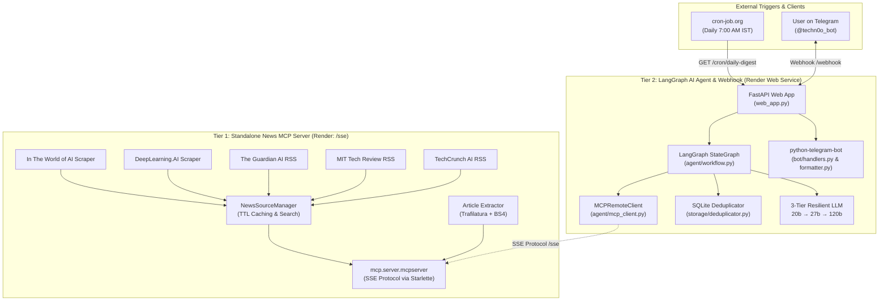

# 🧭 Codebase Architectural Guide: Techno News MCP & Telegram AI Agent

This document provides a comprehensive file-by-file and folder-by-folder architectural breakdown of the **Techno News Intelligence System**.

---

## 🏛️ System Architecture Overview

The system is engineered as a **two-tier, decoupled architecture**:

---

## 📁 Directory & File Breakdown

### 1. Root Level Infrastructure & Configuration

| File | Purpose |
| :--- | :--- |
| `web_app.py` | **Primary ASGI Production Entrypoint**. Hosts the FastAPI app with the Telegram webhook (`/webhook`), health checks (`/`), and asynchronous web cron (`/cron/daily-digest`). Uses `BackgroundTasks`, concurrency mutex locks (`_cron_digest_lock`), and responds in 50ms with 2-byte plain text `OK`. |
| `render.yaml` | **Infrastructure as Code (IaC)**. Configures Render's deployment for both the MCP SSE tool server and the agent web service. |
| `requirements.txt` | Pinned dependencies: `fastapi`, `uvicorn`, `mcp`, `langchain`, `langgraph`, `langchain-groq`, `python-telegram-bot`, `rapidfuzz`, `feedparser`, `trafilatura`, `dateparser`. |
| `Dockerfile` & `docker-compose.yml` | Docker configurations for containerized deployment. |
| `Procfile` | Specifies `web: uvicorn web_app:app --host 0.0.0.0 --port $PORT` for cloud runtimes. |
| `README.md` | Documentation, architecture diagrams, command references, and setup guide. |

---

### 2. `mcp_server/` — Standalone Tool Provider (MCP Protocol)

Exposes news intelligence over the standardized **Model Context Protocol (MCP)** using Server-Sent Events (SSE).

| File | Purpose |
| :--- | :--- |
| `mcp_server/server.py` | Implements `mcp.server.mcpserver.MCPServer` named `techno-news-server`. Registers 4 standardized MCP tools: `get_daily_headlines`, `get_source_news`, `search_news`, and `read_article_full_text`. |
| `mcp_server/app.py` | Wraps the MCP server inside Starlette/Uvicorn. Configures `TransportSecuritySettings(enable_dns_rebinding_protection=False)` so reverse proxies like Render/Cloudflare can connect over HTTPS. |
| `mcp_server/run_server.py` | Local CLI launcher for testing the MCP server standalone. |

#### `mcp_server/sources/` — News Fetchers & Scrapers
- `base.py`: Defines the core `Article` dataclass (`title`, `url`, `source`, `writer`, `topic`, `published_at`, `location`, `summary`) and the abstract `BaseNewsSource` class.
- `manager.py`: Central registry coordinating all 5 news sources. Implements in-memory TTL caching (300s) to prevent hammering upstream sites, multi-source keyword filtering, and search fallback.
- `extractor.py`: Web scraper leveraging `trafilatura` and `BeautifulSoup4` to extract clean, ad-free article bodies when deep reading is requested.
- `in_the_world_of_ai.py`: Scrapes articles and newsletters from *In The World of AI*.
- `deeplearning_ai.py`: Dynamically detects and scrapes Andrew Ng's *The Batch* weekly issue tag (e.g. `/the-batch/tag/oct-23-2026`) using `dateparser`.
- `guardian.py`: Parses *The Guardian AI* RSS feed.
- `mit_tech_review.py`: Parses *MIT Technology Review* RSS feed.
- `techcrunch.py`: Parses *TechCrunch AI* RSS feed.

---

### 3. `storage/` — SQLite Persistence & Deduplication

Backed by SQLite databases in `data/` operating in high-performance **WAL (Write-Ahead Logging)** mode.

| File | Purpose |
| :--- | :--- |
| `storage/database.py` | Manages SQLite connections with timeouts, foreign keys, and indexes. Initializes the `delivered_news` audit table and the persistent `subscribers` table (persisting chat IDs across server restarts). |
| `storage/deduplicator.py` | **Intelligent Deduplication Engine**. Implements 4-tier filtering: 1. **Freshness Filter**: Drops stories older than 168 hours (7 days). 2. **Exact URL & SHA-256 Hash**: Instant lookup against past deliveries. 3. **Tuple Match**: Compares `(source, writer, topic, date)`. 4. **RapidFuzz Similarity**: Computes token set ratio similarity ($\ge 85\%$) to catch rewritten syndicated headlines. |

---

### 4. `agent/` — LangGraph Orchestration & Model Fallbacks

| File | Purpose |
| :--- | :--- |
| `agent/config.py` | Loads `.env` configurations: Groq keys, default models, timezone (`Asia/Kolkata`), schedule (`07:00`), and database paths. |
| `agent/prompts.py` | Contains system prompts: • `NEWSLETTER_PROMPT`: Enforces strict article diversity, 4 structured sections, bold hyperlinks, and takeaways. • `CHAT_SYSTEM_PROMPT`: Strict topic fidelity, anti-jailbreak guardrails, single-search tool policy. |
| `agent/mcp_client.py` | Connects to the remote MCP Server over SSE (`ClientSession`). Discovers tools dynamically and wraps them as LangChain `StructuredTool` objects (`search_news_tool`, `read_article_tool`, `get_source_news_tool`) with local fallback. |
| `agent/tools.py` | Implements the progressive deep-fetch handshake loop (`get_fresh_articles_for_digest`): crawls tiers 4 $\rightarrow$ 8 $\rightarrow$ 16 articles until at least 5 fresh unread articles are found. |
| `agent/workflow.py` | **The Core Intelligence Engine**: • **Resilient LLM**: `openai/gpt-oss-20b` (primary) $\rightarrow$ `qwen/qwen3.8-27b` (fallback 1) $\rightarrow$ `openai/gpt-oss-120b` (fallback 2) with instant 0-second failovers. • **Tool Sanitizer (`clean_messages_for_llm`)**: Strictly pairs `ToolMessage` with `AIMessage(tool_calls=...)` and truncates payloads to 1,200 chars to prevent 400 template errors and 413/429 limits. • **StateGraph**: LangGraph memory checkpointer with `SqliteSaver`. • High-level APIs: `generate_newsletter()` and `chat_with_agent()`. |

---

### 5. `bot/` — Telegram Bot Interface & Formatters

| File | Purpose |
| :--- | :--- |
| `bot/formatter.py` | **Telegram HTML Formatter & Sanitizer**: • `clean_and_format_for_telegram()`: Converts markdown headers (`###`) to bold, list tags (`<li>`) to unicode bullets (`•`), and clean divider lines. • `sanitize_telegram_html()`: Escapes standalone `&` and `<` (e.g. `M&A`, `<100ms`) to `&amp;` and `&lt;` while preserving valid `<b>`, `<a>`, `<i>` tags so Telegram never throws 400 Bad Request. • `html_to_plain_text_with_links()`: Preserves URLs as `Headline (https://url)` in case of fallback. • `chunk_message()`: Safely slices messages under 3,900 chars for Telegram's 4,096 limit. |
| `bot/handlers.py` | Telegram command handlers: • `/start`: Greets user and registers chat ID in SQLite subscribers. • `/digest` or `/news`: Generates and delivers fresh morning briefing. • `/search <topic>`: Queries MCP search across all sources. • `/reset_history`: Wipes delivered records from SQLite to re-test briefings. • `/clear`: Wipes conversational checkpoint memory. • Freeform text: Routes conversational questions to `chat_with_agent`. |
| `bot/telegram_bot.py` | Builds `telegram.ext.Application` and binds handlers. |
| `bot/scheduler.py` | Internal APScheduler daily cron job (used when running bot standalone locally). |
| `bot/main.py` | Local polling entrypoint (`python -m bot.main`). |

---

### 6. `data/` — SQLite Database Stores

- `news_history.db`: Holds `delivered_news` (URLs, content hashes, sources, delivered timestamps) and `subscribers` (persistent chat IDs).
- `agent_memory.db`: Checkpoint database for LangGraph `SqliteSaver`, storing conversational states per `thread_id`.

---

### 7. `tests/` & `scripts/`

- `tests/test_pipeline.py`: Pytest unit test suite covering SQLite initialization, exact deduplication, RapidFuzz similarity matching, and HTML formatting.
- `scripts/install_macos_service.sh`: Configures a macOS `launchd` plist daemon to run the bot 24/7 locally if desired.
- `scripts/uninstall_macos_service.sh`: Removes the `launchd` daemon.
